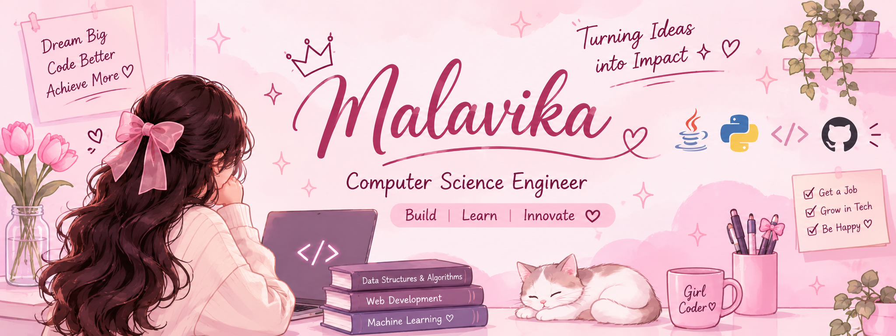
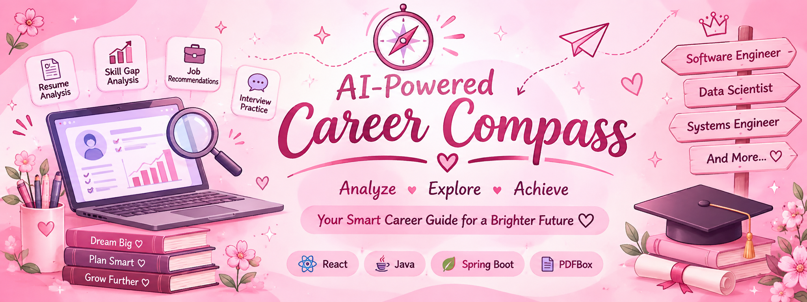
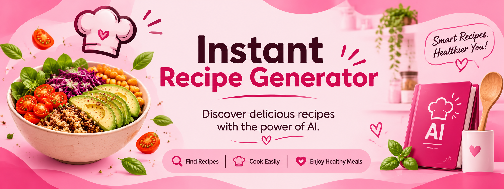
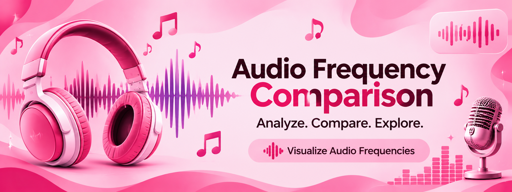

# 🌸 Malavika P. | Software & Systems Engineering

 

  

  

---

<h2 align="center">୨୧ ABOUT ME ୨୧</h2>

### Hi! I'm Malavika P. 🌷

**I don't just learn technology. I build with it.**

A Computer Science Engineering student passionate about software development, problem-solving and intelligent applications.

Currently preparing for technical placements while building practical projects and strengthening my programming skills.

<table>
<tr>
<td width="50%" valign="top">

### ✨ What I Do

- Develop practical software projects.
- Solve programming challenges using Java.
- Explore AI-powered applications.
- Work with frontend and backend technologies.
- Learn through hands-on development.

</td>
<td width="50%" valign="top">

### 🎀 Current Goals

- Strengthen Java and DSA.
- Prepare for technical placements.
- Improve problem-solving skills.
- Explore software and systems engineering.
- Build reliable real-world applications.

</td>
</tr>
</table>

---

<h2 align="center">୨୧ TECHNICAL SKILLS ୨୧</h2>

**PROGRAMMING LANGUAGES**

  

**FRAMEWORKS & DEVELOPMENT**

  

**DATABASES & TOOLS**

 

**AI & TESTING**

---

<h2 align="center">୨୧ FEATURED PROJECTS ୨୧</h2>

<table>
<tr>

<!-- TRUSTTEST AI -->

<td width="50%" valign="top">

<h3>🛡️ TrustTest AI</h3>

An automated LLM quality and reliability testing platform designed to evaluate AI-generated responses.

**Key Features:**
- Semantic similarity evaluation.
- Regression testing.
- Safety testing.
- Multi-turn conversation testing.
- Interactive analytics dashboard.
- Automated test execution.

**Technologies:** Python · Streamlit · SQLite · Pytest · Sentence Transformers

</td>

<!-- AI CAREER COMPASS -->

<td width="50%" valign="top">

<h3>🤖 AI-Powered Career Compass</h3>

An intelligent career guidance application designed to help candidates understand their skills and prepare for job opportunities.

**Key Features:**
- Resume analysis and ATS scoring.
- Skill-gap identification.
- Personalized job recommendations.
- Interview question practice.
- Company application tracking.

**Technologies:** React · Java · Spring Boot · PDFBox

Backend development and integration are still in progress.

</td>
</tr>

<tr>

<!-- INSTANT RECIPE GENERATOR -->

<td width="50%" valign="top">

<h3>🍲 Instant Recipe Generator</h3>

A smart recipe recommendation web application that helps users discover recipes based on ingredients available in their kitchen.

**Key Features:**
- Image-based ingredient detection.
- Manual ingredient input.
- Personalized recipe recommendations.
- Cuisine and dietary preference filters.
- Cooking time and serving customization.
- Nutritional information.
- Favourite recipes and ratings.
- Shopping list generation.
- Surprise Me feature.

**Technologies:** Python · Flask · HTML · CSS · JavaScript · SQLite · Gemini API

</td>

<!-- AUDIO FREQUENCY COMPARISON -->

<td width="50%" valign="top">

<h3>🎵 Audio Frequency Comparison</h3>

A project focused on voice similarity evaluation using frequency-domain analysis.

**Focus Areas:**
- Audio signal processing.
- Frequency-domain analysis.
- Voice similarity evaluation.

**Technology:** Python

</td>

</tr>
</table>

---

<h2 align="center">୨୧ CURRENTLY BUILDING ୨୧</h2>

### 🚀 Growing Through Development

Currently improving my development skills through hands-on projects, backend integration and placement preparation.

| Area | Current Focus |
|:---|:---|
| Java | Coding and problem-solving |
| DSA | Placement-level practice |
| Backend | Java & Spring Boot |
| Frontend | React |
| AI | Semantic evaluation and intelligent applications |
| Career | Software / Systems Engineering |

---

<h2 align="center">୨୧ GITHUB ACTIVITY ୨୧</h2>

 <br

